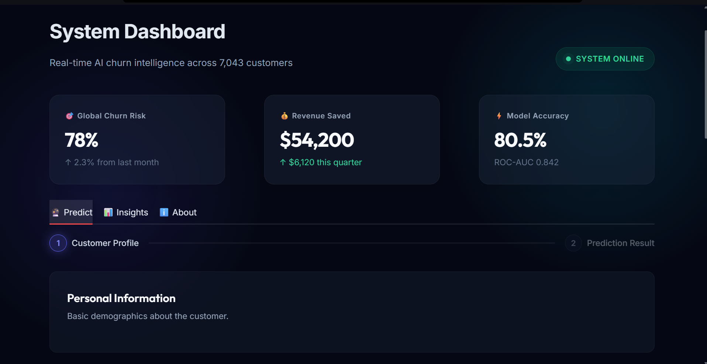
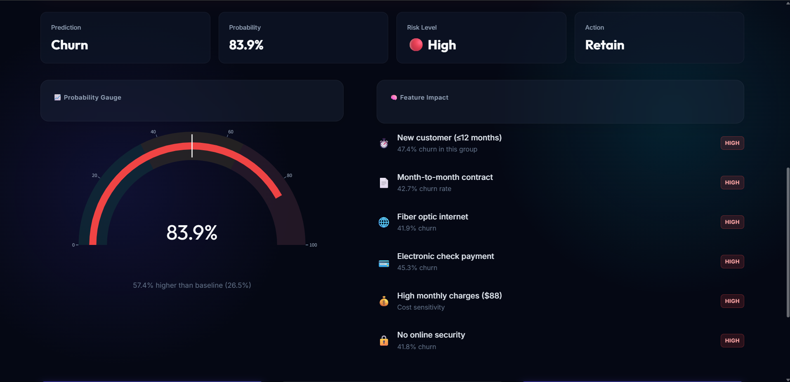

<div align="center">


<a href="https://git.io/typing-svg">
  
</a>

**Predict which customers are about to leave, and see why, before the revenue is gone.**

<p>
  <a href="https://churniq-prediction.onrender.com/"></a>
</p>

<p>
  
  
  
  
  
</p>

<p>
  
  
  
</p>

</div>

---

## 📌 Overview

Acquiring a new customer costs far more than keeping an existing one, yet most telecom teams only learn a customer is leaving *after* they have gone.

**ChurnIQ** is an end-to-end machine learning project that closes that gap. It takes a customer's profile (demographics, contract, billing and subscribed services), returns the **probability that the customer will churn**, and shows which factors put them at risk, so a retention team knows who to contact first.

The project covers the full workflow: data exploration → preprocessing → model comparison → a saved scikit-learn pipeline → a deployed Streamlit web app.

---

## 📸 Screenshots

<table>
  <tr>
    <td width="50%" align="center">
      <b>📊 System Dashboard</b><br/><br/>
      
    </td>
    <td width="50%" align="center">
      <b>🔮 Prediction Result</b><br/><br/>
      
    </td>
  </tr>
</table>

---

## ✨ Features

- **Guided prediction form:** a two-step flow (customer profile → result) covering all 19 input features.
- **Churn probability and verdict:** predicted class, probability, risk level (Low / Medium / High) and a suggested action (Retain / Monitor).
- **Probability gauge:** the score is shown against the 50% decision threshold and colour-coded by risk tier.
- **Baseline comparison:** every result is compared with the dataset's 26.5% average churn rate.
- **Risk-factor breakdown:** highlights the factors behind the result (tenure, contract, internet type, payment method, charges, security add-on), each with the churn rate observed for that group in the data.
- **Insights tab:** churn rate by contract type and by internet service.
- **CSV export:** download the customer profile and prediction as a report.
- **Responsive dark UI:** a glassmorphism "Deep Space Neon" theme that works on desktop and mobile.

---

## 🧠 Model

| | |
|---|---|
| **Dataset** | [IBM Telco Customer Churn](https://github.com/IBM/telco-customer-churn-on-icp4d), 7,043 customers, 21 columns, 26.5% churn |
| **Target** | `Churn` (Yes / No) |
| **Split** | 80 / 20 stratified (5,634 train · 1,409 test), `random_state=42` |
| **Preprocessing** | `StandardScaler` on 4 numeric features · `OneHotEncoder(handle_unknown="ignore")` on 15 categorical features |
| **Final model** | `LogisticRegression(max_iter=1000)` inside a single scikit-learn `Pipeline` |
| **Artifact** | `model/churniq_model.pkl` (preprocessing and classifier saved together) |

### Data cleaning

- `TotalCharges` was stored as text, with 11 blank values (all customers with `tenure = 0`). They were converted to numeric and set to `0`.
- `customerID` was dropped, since it carries no predictive signal.

### Model comparison

Five models were trained on the same split and evaluated on the held-out test set:

| Model | Accuracy | Churn Precision | Churn Recall | Churn F1 | ROC-AUC |
|---|:---:|:---:|:---:|:---:|:---:|
| Gradient Boosting | 0.803 | 0.666 | 0.516 | 0.581 | **0.843** |
| **Logistic Regression** ✅ | **0.806** | 0.657 | 0.559 | 0.604 | 0.842 |
| Decision Tree (balanced) | 0.740 | 0.507 | 0.789 | 0.617 | 0.828 |
| Random Forest (balanced) | 0.783 | 0.619 | 0.473 | 0.536 | 0.823 |
| SVM, RBF (balanced) | 0.744 | 0.512 | 0.773 | 0.616 | 0.821 |

**Why Logistic Regression?** It had the best accuracy and the best churn F1 among the top-AUC models, and its ROC-AUC was within 0.001 of Gradient Boosting. It is also fast, well calibrated for probabilities, and easy to explain.

### Final model performance (test set, threshold 0.5)

| Metric | Value |
|---|:---:|
| Accuracy | 80.6% |
| ROC-AUC | 0.842 |
| PR-AUC | 0.634 |
| Churn precision | 0.66 |
| Churn recall | 0.56 |
| Churn F1 | 0.60 |

```text
Confusion matrix            Predicted: Stay   Predicted: Churn
Actual: Stay                      926               109
Actual: Churn                     165               209
```

### Threshold trade-off

At the default 0.5 threshold the model misses roughly 44% of churners. Lowering the threshold to **0.35** raises churn recall from **0.56 to 0.71**, at the cost of lower precision (0.66 → 0.54). That is a sensible trade when contacting a customer is cheap and losing one is expensive. The deployed app uses 0.5 and colours risk as Low < 35%, Medium 35–65%, High > 65%.

---

## 🔍 Key Findings from EDA

| Factor | Higher churn | Lower churn |
|---|---|---|
| **Contract** | Month-to-month: **42.7%** | One year: 11.3% · Two year: 2.8% |
| **Internet service** | Fiber optic: **41.9%** | DSL: 19.0% · No internet: 7.4% |
| **Payment method** | Electronic check: **45.3%** | Automatic payments: ~16% |
| **Tenure** | First 12 months: **47.4%** | 48+ months: 9.5% |
| **Online security** | No add-on (internet users): **41.8%** | |

---

## 🎯 Example Prediction

Input:

| Field | Value | Field | Value |
|---|---|---|---|
| Tenure | 2 months | Contract | Month-to-month |
| Internet | Fiber optic | Payment | Electronic check |
| Monthly charges | $89.85 | Total charges | $180.00 |
| Online security | No | Tech support | No |
| Paperless billing | Yes | Partner / Dependents | No / No |

Output: **Churn predicted**, probability about **61%** (Medium risk), recommended action **Retain**.

---

## 🗂️ Project Structure

```text
ChurnIQ/
├── app.py                              # Streamlit application
├── requirements.txt                    # Python dependencies
├── model/
│   └── churniq_model.pkl               # Trained scikit-learn pipeline
├── notebooks/
│   └── ChurnIQ_Data_Understanding.ipynb  # EDA, modelling and evaluation
├── assets/
│   ├── dashboard.png                   # README screenshot
│   └── prediction.png                  # README screenshot
└── README.md
```

---

## 🚀 Run Locally

```bash
# 1. Clone the repository
git clone https://github.com/Adarsh-SSingh/ChurnIQ.git
cd ChurnIQ

# 2. Create and activate a virtual environment
python -m venv venv
source venv/bin/activate        # Windows: venv\Scripts\activate

# 3. Install dependencies
pip install -r requirements.txt

# 4. Launch the app
streamlit run app.py
```

The app opens at `http://localhost:8501`.

> **Note:** the saved model was created with `scikit-learn==1.9.0`. Keep that version (it is pinned in `requirements.txt`) so the pickle loads correctly.

> **Live demo note:** the app is hosted on Render's free tier, so the first load after a period of inactivity can take about a minute while the service wakes up.

---

## ⚠️ Limitations

- The dashboard cards at the top (global churn risk and revenue saved) are **illustrative placeholders**, not computed from live data.
- The risk-factor breakdown comes from churn rates observed in the dataset, not from the model's coefficients, so it is descriptive rather than a per-customer explanation of the score.
- The model was trained on a single public dataset and has not been validated on real operator data.

## 🔭 Future Improvements

- Per-customer explanations using model coefficients or SHAP.
- Threshold selector in the UI, tied to the cost of a retention offer versus a lost customer.
- Batch prediction from an uploaded CSV.
- Hyperparameter tuning and cross-validation.
- Feature engineering (for example, tenure groups), which did not help in a first test.

---

## 🤝 Connect

<div align="center">

<a href="https://www.linkedin.com/in/adarsh-singh-6891a6254/"></a>
<a href="https://github.com/Adarsh-SSingh"></a>
<a href="mailto:adarshsingh748263@gmail.com"></a>

<br/><br/>

If this project helped you, consider giving it a ⭐


</div>